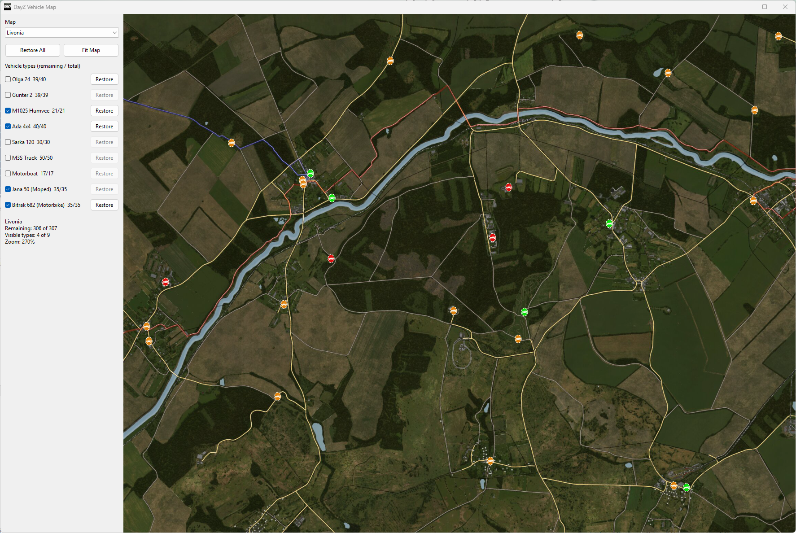
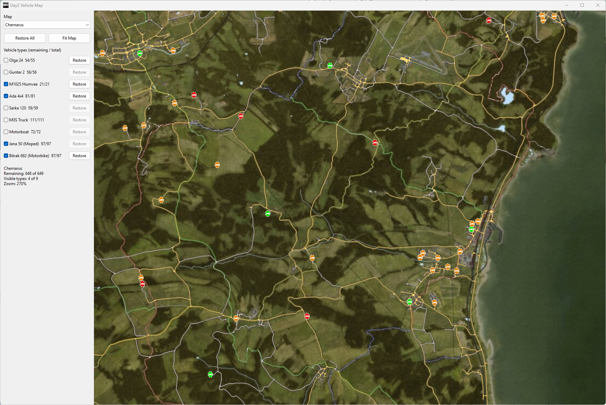

# DayZ Vehicle Map

DayZ Vehicle Map is a portable native Windows application for viewing possible
vehicle spawn locations across several DayZ maps. It runs completely offline
and combines satellite map images, vector road overlays, and map-specific
vehicle spawn data in one responsive desktop interface.

Latest release: **v1.1.0 (2026-10-17)** — corrected Nasdara roads and structures,
rendered tile caching and background rendering for faster panning and zooming,
and a 35 FPS cap.

Download the [v1.1.0 release](https://github.com/FeliciaDayZ/DayZ-Vehicle-Map/releases/tag/v1.1.0).
The portable ZIP includes the executable and required map data.

See [Patch notes](CHANGELOG.md) for recent updates.

## Supported maps

- Chernarus
- Livonia
- Sakhal
- Namalsk
- Deer Isle
- Bitterroot
- Banov
- Nasdara (Badlands / `dayzOffline.nasdara`)

## Features

- Filter markers by vehicle type, with multiple types visible at once.
- Left-click an individual marker to check it off and hide it.
- Right-click a marker to toggle its state between yellow and green.
- Middle-click a marker to toggle its state between yellow and red.
- Restore all markers on the current map or restore one vehicle type.
- Zoom with the mouse wheel and drag the map to pan.
- Preserve checked, green, and red marker states between runs.
- Keep marker state isolated by map, vehicle type, and spawn coordinates.
- Render paved and dirt roads as scalable vector lines while zooming.
- Show Nasdara structures with model footprints and detailed top-down pictures.
- Cache rendered structure tiles and prepare newly visible detail in the background.
- Limit map rendering to at most 35 FPS, with no continuous redraws while idle.
- Use no Internet connection, registry settings, or external runtime.

## Screenshots

### Livonia



### Chernarus



## Using the program

Keep `DayZVehicleMap.exe` beside the `data` directory, then run the executable.
When upgrading, replace both the executable and `data` directory while keeping
your existing `checked_state.txt` file.

- Select a map from the map dropdown.
- Enable or disable vehicle types with the filter controls.
- Use the mouse wheel to zoom around the cursor.
- Hold and drag the left mouse button to pan.
- Left-click a visible marker to check and hide that spawn point.
- Right-click a marker to mark it green.
- Middle-click a marker to mark it red.
- Use Restore All or the per-type Restore controls to reset markers.

The application writes personal marker state to `checked_state.txt` beside the
executable. That file is optional and is created automatically when needed.

The 35 FPS limit is always enabled, including during panning, zooming, and
resizing. The app combines rapid input into the next frame, reuses the last
frame for unchanged window repaints, and stops map rendering while minimized.
Expensive frames can reduce the frame rate below 35 FPS; the app leaves at least
1/35 second (about 28.6 ms) of idle time between map renders to reduce CPU
contention while playing.

Map images and geometry stay in memory. Nasdara's structure layer also keeps
rendered tiles for recently visited areas and zoom levels, with nearby tiles
prepared ahead of panning. A background worker fills missing tiles while the
UI reuses available detail; newly visited areas may briefly gain detail after
movement. The worker sleeps when finished and stops queued work when the map
is hidden or switched. Its tile cache is bounded at about 124 MiB, plus a
96 MiB decoded model-picture cache. Both are released when the app closes.

## Vehicle spawn counts

| Map | Spawn markers |
|---|---:|
| Chernarus | 649 |
| Livonia | 307 |
| Sakhal | 431 |
| Namalsk | 554 |
| Deer Isle | 190 |
| Bitterroot | 99 |
| Banov | 239 |
| Nasdara | 435 |

Vehicle filters include the supported cars, trucks, boats, Jana 50 mopeds, and
Bitrak 682 motorbikes present in each map's source data.

## Building

The project is written in C17 for native 64-bit Windows using the Win32 API and
GDI+. The supplied build script expects w64devkit under `C:\winprog\C\bin`.

Run:

```bat
build.bat
```

The resulting GUI executable is written to the project root as
`DayZVehicleMap.exe`.

To rebuild and run the native model, persistence, GUI smoke, and frame pacing tests:

```bat
test.bat
```

The suite also checks structure rotation, non-unit scale, picture orientation,
zoom, culling, malformed data, tile reuse and seams, background rendering,
bounded cache eviction, and idle behavior. These checks use Python with Pillow at
`C:\winprog\python\python.exe`; the application still needs no Python runtime.

## Runtime layout

The application resolves all runtime files relative to the executable rather
than the current working directory:

```text
DayZVehicleMap.exe
data/
  marker.png
  maps/
  roads/
  objects/
    nasdara/
      nasdara.objects
      pictures/
  spawns/
```

The files under `data/source` and the programs under `tools` are retained for
data provenance and regeneration; they are not required during normal use.

## Data sources

- Vanilla Chernarus, Livonia, and Sakhal vehicle positions come from DayZ
  Server Experimental mission data.
- Namalsk, Deer Isle, Bitterroot, and Banov use their respective mission data.
- Nasdara vehicle positions come from the installed Badlands central economy PBO.
- Satellite map imagery was assembled from iZurvive map tiles, except Nasdara,
  which is assembled directly from the installed terrain's satellite textures.
- Chernarus and Livonia road geometry was derived from Survivorm route data.
- Community-map road geometry was exported from the corresponding terrain WRP
  data; Sakhal roads were traced from high-resolution XAM topographic tiles.
  Traced roads are approximate.
- Nasdara structure footprints, placements, top-down model pictures, and road
  geometry come from [DayZed.GG's Nasdara map](https://dayzed.gg/map/nasdara).
  The source data derives from DayZ's terrain and models. Source versions and
  hashes are retained in `data/objects/nasdara/source.json`.

Runtime CSV and road files are included, so DayZ Server and workshop maps do
not need to remain installed.

### Regenerating Nasdara

`tools/build_nasdara_map.py` requires Python with Pillow and DayZ Tools. It reads
the installed PBOs, verifies the terrain extent and texture calibration, assembles
the 4096 x 4096 image, and retains the source vehicle XML in `data/source/nasdara`.
Adjust these paths to your installation:

```powershell
python tools/build_nasdara_map.py --addons 'G:\SteamLibrary\steamapps\common\DayZ\nasdara\addons' --dayz-tools 'G:\SteamLibrary\steamapps\common\DayZ Experimental Tools' --temp 'C:\hypevidia\vehiclemap-temp\nasdara'
./tools/generate_vehicle_data.ps1 -MapIds nasdara
python tools/build_nasdara_objects.py --cache 'C:\hypevidia\vehiclemap-temp\nasdara\dayzed' --output data/objects/nasdara --roads-output data/roads/nasdara.roads
```

Nasdara has 231 car/truck markers and 102 possible locations for each motorbike
type; its boat event is inactive. Both motorbike types share the same locations.
The encrypted world archive is not needed for this workflow. Structure and road
regeneration downloads the published DayZed.GG data; the application itself
remains fully offline. The exporter retains per-instance rotation and scale,
model-space outlines, and the affine mapping from picture pixels into model
metres. Underground tunnel objects are excluded from the surface layer.

The renderer culls objects against the viewport and keeps decoded model pictures
in a bounded cache. Buildings appear before small props as the map zooms in;
detailed pictures use the same world transform as their outlines. Larger surface
models draw before the smaller objects that stand on them.

The older raster road extractor remains available for Sakhal. Before tracing,
it fills enclosed raster holes of up to 16
pixels. After thinning, it removes terminal branches up to 8 pixels long that
attach to a junction, then simplifies the remaining centerlines. This suppresses
compression and edge artifacts while retaining larger loops and road junctions.
At the original Nasdara tracing resolution, one pixel was one metre.

The extractor's regression tests include the Nasdara bend that exposed these
artifacts, exercised as both paved and dirt road geometry:

```powershell
Push-Location tools/sakhal_road_trace
go test ./...
Pop-Location
```
